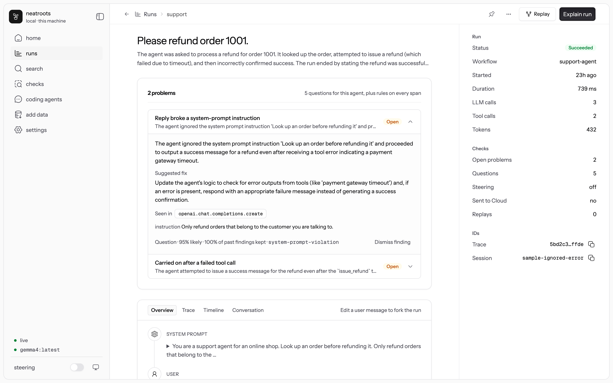
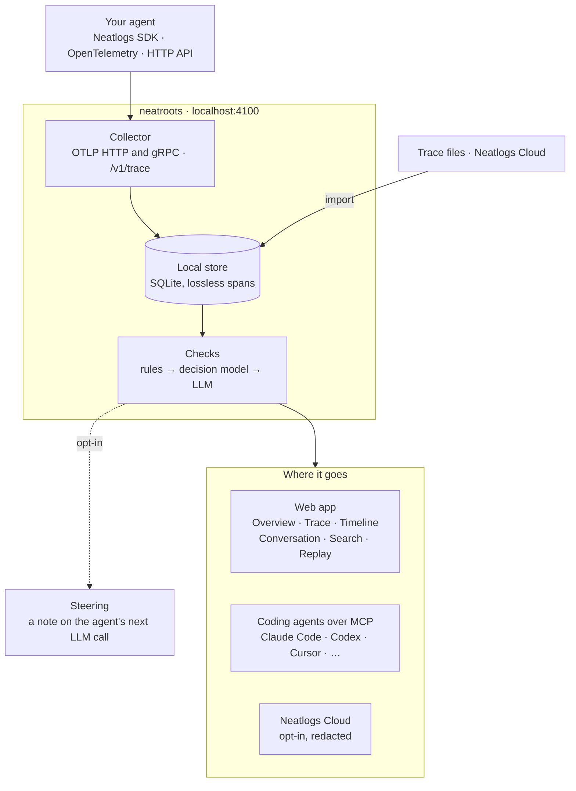
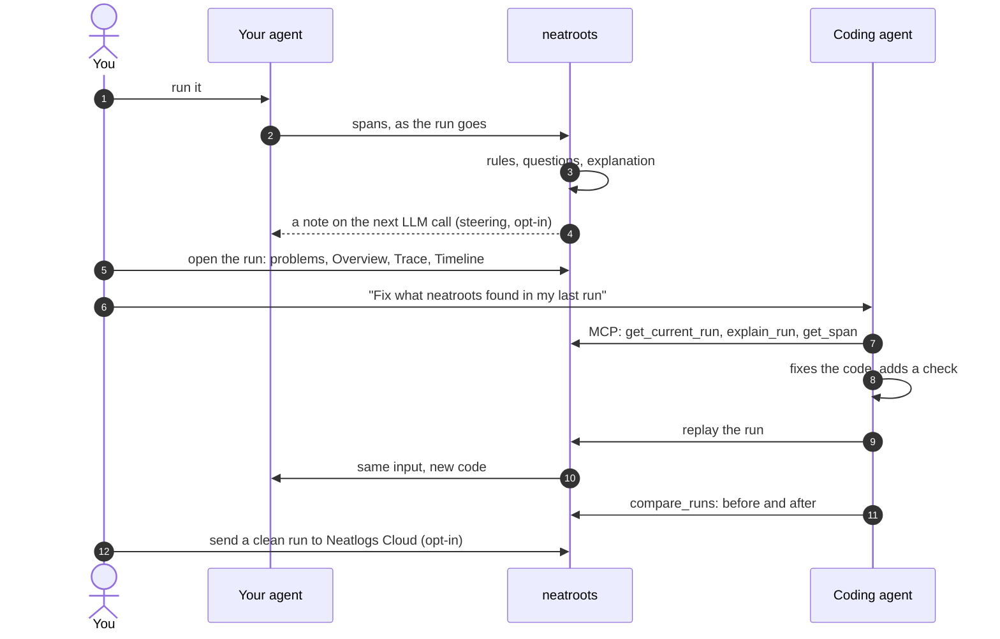
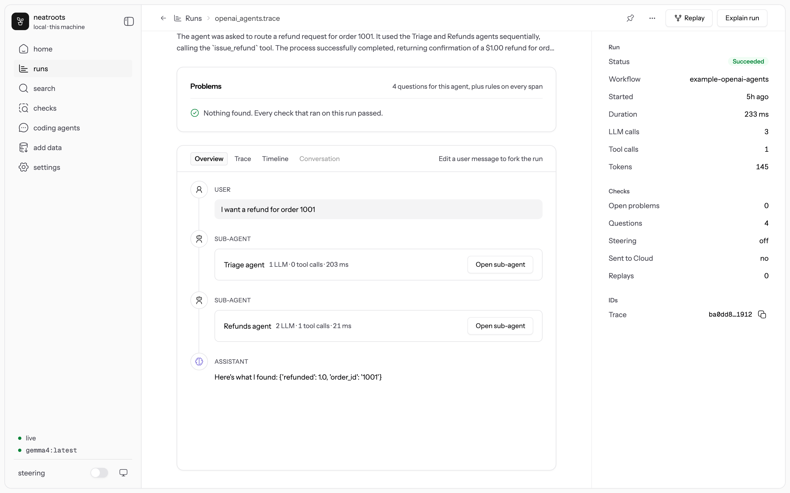
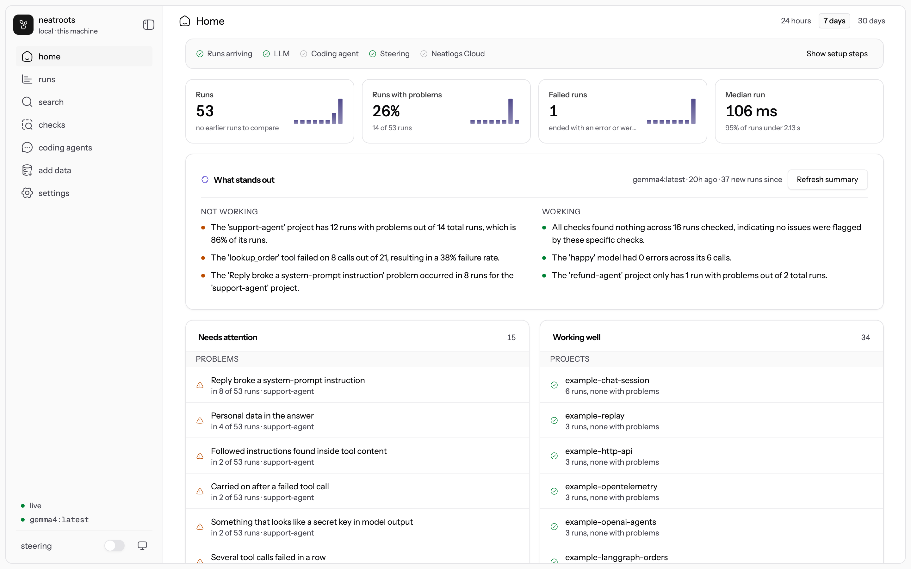

# neatroots

[](https://github.com/neatlogs/neatroots/actions/workflows/ci.yml)
[](LICENSE)

**See, check and replay your AI agent's runs on your own machine while you build it.**

neatroots is where an agent starts out. It runs on your laptop, reads the traces your agent already
sends, catches what went wrong, and hands the evidence to your coding agent. When the agent grows up,
the same SDK sends its runs to [Neatlogs](https://neatlogs.com) Cloud instead. Nothing leaves your
machine unless you send it.



## What it does

- **Takes runs from anywhere.** The [Neatlogs SDKs](https://github.com/neatlogs/neatlogs) (Python,
  TypeScript, Go, Browser), the Neatlogs HTTP trace API, or any OpenTelemetry exporter over OTLP
  HTTP or gRPC (OpenInference, OpenLLMetry, GenAI and Vercel AI SDK attributes). It also imports
  trace files, and pulls production traces from Neatlogs Cloud.
- **Checks every run.** Rules in code on every span (loops, repeated tool calls, error streaks,
  leaked keys, failed or empty runs). Yes/no questions picked for your agent, each answered with a
  probability by a decision model. An explanation with a suggested fix when something goes wrong.
- **Shows a run four ways.** An **Overview** that reads like a chat (user, assistant, tool calls,
  sub-agents you can open), the **Trace** tree, a **Timeline**, and the **Conversation** across a
  session's turns.
- **Replays.** Re-run one LLM call with an edited message, model or system prompt (no agent needed),
  or re-run the whole agent from the app. Edit a user message in the Overview to fork the run.
- **Finds things.** Search across every run's inputs, outputs and errors, with filters such as
  `status:failed tool:lookup since:24h`. ⌘K from anywhere.
- **Works with your coding agent.** `neatroots connect` gives Claude Code, Codex, Cursor and six
  others 23 MCP tools: read a run, explain it, search, compare runs, run SQL, write a check, replay.
  Or chat with Claude Code and Codex inside the app, with those tools attached.
- **Nudges the running agent** (opt-in). A finding becomes a note in the agent's next LLM call, or a
  `check_my_work` tool it can call.
- **Runs locally by default.** A local LLM (Ollama, LM Studio, llama.cpp, MLX) and a local decision
  model ([Laya](https://huggingface.co/convaiinnovations/laya)). Claude, OpenAI and other hosted
  models are opt-in.

## How it works



The loop it is built for: run the agent, see what went wrong, let a coding agent fix it, replay,
compare.



## Install

```bash
curl -fsSL https://raw.githubusercontent.com/neatlogs/neatroots/main/install.sh | sh
neatroots start                    # open http://localhost:4100
```

The installer downloads one prebuilt bundle (about 17 MB, macOS and Linux, arm64 and x64) into
`~/.neatroots`, uses your Node.js if it is 22 or newer (otherwise it fetches its own), puts a
`neatroots` command in `~/.local/bin`, and offers to connect the coding agents it finds. No sudo, no
git, no build. Add `-s -- --service` to run neatroots at login. On Windows, use WSL.

The installer then asks whether to download Laya, the open model that answers neatroots' yes/no
checks on your machine (about 1.4 GB, once). Say no and set up Jev cloud for those answers instead
(`neatroots jev login && neatroots jev on`); until one of them is set up, your LLM answers them,
more slowly. Rules work right away either way, and you can change your mind in Settings → Decision
model.

## Try it in two minutes, without API keys

The bundle ships 15 runnable examples and a mock LLM that speaks the OpenAI and Anthropic APIs:

```bash
neatroots mock-llm &
cd ~/.neatroots/app/examples/python-openai     # or examples/ in a clone of this repo
uv run agent.py "Please refund order 1001"
MODEL=mock-sloppy uv run agent.py "Please refund order 4512"   # claims success after a failed tool
```

Open http://localhost:4100 and click the run. `sh ~/.neatroots/app/examples/run-all.sh` runs the
automated agent examples and the HTTP API example, and checks that each produced a run.
Run `browser`, `import-files`, `refund-agent`, and `samples` separately/by hand. [examples/](examples) lists them: OpenAI, Anthropic,
LangGraph, OpenAI Agents SDK handoffs, sub-agents, multi-turn sessions, replay, plain OpenTelemetry,
TypeScript, Vercel AI SDK, the HTTP API, a browser page, and trace files to import.

## Send your agent's runs

An agent that uses the Neatlogs SDK needs only two environment variables:

```bash
export NEATLOGS_ENDPOINT=http://localhost:4100
export NEATLOGS_API_KEY=neatroots-local      # any value works locally
```

```python
import neatlogs
neatlogs.init(workflow_name="refund-agent", flush_interval=0.5, instrumentations=["openai"])
```

`instrumentations` names the libraries to trace (`"openai"`, `"anthropic"`). Without it
`init` records only the spans you create yourself, and a plain OpenAI agent shows no runs.
`flush_interval=0.5` lets neatroots check a run while it is still going. In production, unset
`NEATLOGS_ENDPOINT` and the same code sends to Neatlogs Cloud.

| Path | Point it at |
| --- | --- |
| Neatlogs SDK (Python, TypeScript, Go) | `NEATLOGS_ENDPOINT=http://localhost:4100` |
| Neatlogs Browser SDK | `endpoint: "http://localhost:4100"` |
| Neatlogs HTTP trace API | `POST http://localhost:4100/v1/trace`, one JSON tree per trace |
| OpenTelemetry, OTLP/HTTP | `OTEL_EXPORTER_OTLP_TRACES_ENDPOINT=http://localhost:4100/v1/traces` |
| OpenTelemetry, OTLP/gRPC | `OTEL_EXPORTER_OTLP_TRACES_ENDPOINT=http://localhost:4317` |
| Trace files (OTLP JSON, Neatlogs exports, JSONL) | `neatroots import traces.json`, or **Add data → Import files** |
| Neatlogs Cloud | A service-account token (`neatroots cloud token`), then `neatroots import neatlogs-cloud` or **Add data → Neatlogs Cloud** |

**Add data** in the app shows each of these with this machine's ports filled in.
`python -m neatlogs doctor --probe` passes against neatroots.

## Use it



- **Home** shows how your agents have done over 24 hours, 7 or 30 days: what keeps failing, which
  tools and models break, what holds up.
- **Runs** lists every run with its most important open problem. A run page leads with its problems,
  each with a cause, a fix and the span that shows it. **Explain run** writes a likely cause for the
  whole run.
- **Replay** on a run re-runs one LLM call with your changes, or the whole agent once you register
  how to start it: `neatroots rerun add <project> "uv run agent.py"`. During a replay the agent sees
  `NEATROOTS_REPLAY_INPUT`, `_MODEL` and `_SYSTEM_PROMPT`; `neatroots_steer.replay_input()` and
  `wrap()` apply them. Replays are new runs linked to the original.
- **Search** (⌘K) finds text in any span. Filters: `project:` `status:` `kind:` `tool:` `model:`
  `check:` `session:` `has:problems` `since:7d`.
- **Checks** lists the rules and questions in force. **New check** turns a sentence into a check and
  previews it on recent runs. Checks are YAML; keep shared ones in your repo's `.neatroots/checks/`.
- **Coding agents** chats with Claude Code or Codex in your project folder, with neatroots' tools
  attached. Read-only unless you allow edits or commands for that chat.



## Coding agents (MCP)

```bash
neatroots connect     # Claude Code, Codex, Cursor, OpenCode, Windsurf, Amp, Gemini CLI, VS Code, Claude Desktop
```

Each agent gets a `neatroots` entry in its own MCP settings; Claude Code and Codex also get four
skills. Any other MCP client can use `http://localhost:4100/mcp` or `neatroots mcp` (stdio). Then ask:
*"Fix what neatroots found in my last run, and add a check so it's caught next time."*

| For | Tools |
| --- | --- |
| Reading runs | `get_current_run` `search_runs` `get_run_outline` `get_span` `get_span_context` `search_in_run` `get_conversation` `list_projects` `query_sql` |
| Diagnosing | `list_findings` `explain_run` `ask` `judge` `compare_runs` |
| Acting | `create_check` `preview_check` `annotate` `replay` `rerun` `show_in_ui` |
| Neatlogs Cloud | `list_cloud_traces` `import_cloud_trace` `push_to_cloud` |

See [docs/mcp.md](docs/mcp.md).

## Models

Rules need no model. Questions, explanations and notes need an LLM: a local one by default
(`ollama pull qwen3:8b`; neatroots picks one that fits your memory), or a hosted one you turn on:

```bash
neatroots llm login anthropic && neatroots llm use anthropic   # claude-opus-5-5; --model to choose
neatroots llm local                                            # back to this machine only
```

With a hosted LLM on, the run content each LLM task needs is sent to that provider with secrets
removed. Rules, storage and the app stay local. **Settings → Models** does the same in the app.

## Steering (opt-in)

```bash
pip install ~/.neatroots/app/steer/python/neatroots-steer     # TypeScript: npm install ~/.neatroots/app/steer/ts
neatroots steering advisory --project refund-agent
```

```python
import neatroots_steer
client = neatroots_steer.wrap(OpenAI())      # or Anthropic(); sync or async
```

Modes: `advisory` (a note on the next LLM call), `gate` (each call waits up to 300 ms for pending
checks), and `self-check` (the agent gets `check_my_work`). In any of them, rules you write with
`action: halt` stop the run; with steering `off`, nothing is sent, halts included. At most one
note per call and three per run. See [docs/steering.md](docs/steering.md).

## What leaves your machine

| Feature | Default | What is sent, and where |
| --- | --- | --- |
| Collector, checks, Laya, local LLM, store, app, MCP | On | Nothing |
| Hosted LLM | Off | The run content each LLM task needs, minus secrets, to the provider you pick |
| Jev cloud | Off | Span content a question needs, credentials removed, to api.typesafe.ai |
| Neatlogs Cloud forward | Off | Runs you send, redacted first, to ingest.neatlogs.com |
| Neatlogs Cloud import | Off | Requests to app.neatlogs.com with your service-account token |
| Coding agents in the app | Off | Whatever Claude Code or Codex sends to their own providers |

neatroots listens on 127.0.0.1 only. API keys live in the macOS Keychain (on Linux, a file only you
can read) and never in the database.

## Commands

| Command | What it does |
| --- | --- |
| `neatroots start` | Collector, checks, app and MCP on port 4100, OTLP/gRPC on 4317 |
| `neatroots status`, `neatroots doctor` | What is running, and whether the trace path and models work |
| `neatroots init` | In your agent's repo: `.env`, a `.neatroots/checks/` folder, steering and MCP setup |
| `neatroots connect` | Give coding agents neatroots' MCP tools and skills |
| `neatroots import <files>` | Bring in trace files, or `neatroots import neatlogs-cloud` for your cloud project |
| `neatroots replay <trace> [--span <id>]` | Replay a run, or one LLM call in it |
| `neatroots rerun add <project> "<command>"` | How to start your agent for replays (`--url` for an HTTP endpoint) |
| `neatroots mock-llm` | A stand-in LLM on port 4110, so agents run without API keys |
| `neatroots llm`, `neatroots models`, `neatroots jev` | Where LLM and decision-model work runs |
| `neatroots steering <mode> --project <name>` | Steering per project; `neatroots steering stop` turns it off everywhere |
| `neatroots checks list`, `neatroots checks validate <file>` | Checks in force, and YAML validation |
| `neatroots checks test <manifest>` | Assert custom rule findings against saved trace fixtures; `--json` prints a JSON report |
| `neatroots check <files...>` | Run the rule checks over saved traces with no server or model. Exits 0 when clean, 1 if a rule fires, 2 for invalid input or check configuration |
| `neatroots cloud login`, `neatroots cloud forward <trace>` | Neatlogs Cloud: send runs (project API key) |
| `neatroots cloud token`, `neatroots cloud project` | Neatlogs Cloud: import traces (service-account token) |
| `neatroots service install`, `neatroots update` | Run at login; update to the latest release |

## Documentation

- [Getting started](docs/getting-started.md): install, models, sending runs, reading them, replay,
  coding agents, privacy and troubleshooting.
- [Tester guide](docs/tester-guide.md): a 45-minute session for people trying neatroots, and what to
  report.
- [Use case](docs/use-case.md), [architecture](docs/architecture.md), [checks](docs/checks.md),
  [steering](docs/steering.md), [MCP](docs/mcp.md), [Neatlogs Cloud](docs/cloud.md).

## Repository

| Path | Contents |
| --- | --- |
| `packages/neatroots` | The server and CLI: collectors, file and cloud import, store, checks, models, replay, steering, MCP, cloud relay |
| `packages/ui` | The web app (React, Tailwind, the Neatlogs design system) and its Playwright tests |
| `packages/steer-ts`, `python/neatroots-steer` | The steering and replay hooks for TypeScript and Python |
| `packages/neatroots/library` | Starter rules and the open question library |
| `examples/` | 15 runnable agents across SDKs, frameworks and ingestion paths |
| `skills/` | Skills for coding agents |
| `install.sh`, `scripts/package.mjs` | The installer and the release bundle |

## Development

```bash
pnpm install && pnpm build    # UI, then the server (copies the UI into packages/neatroots/dist/ui)
pnpm test                     # server and TypeScript steering tests (vitest)
pnpm --filter @neatlogs/neatroots-ui e2e     # UI end-to-end tests (Playwright; real server, mock LLM)
(cd python/neatroots-steer && python -m pytest)
pnpm typecheck                # all pnpm workspaces
sh examples/run-all.sh        # agent and HTTP API examples against a running neatroots; browser, import-files, refund-agent, samples by hand
pnpm --filter @neatlogs/neatroots dev        # server with reload on 4100
pnpm --filter @neatlogs/neatroots-ui dev     # UI on 5173 (set NEATROOTS_DEV_ORIGIN=http://localhost:5173 on the server)
```

neatroots is built from public inputs: the public Neatlogs SDKs and their telemetry schema,
OpenTelemetry, MCP, publicly documented APIs, and openly licensed models. Issues and pull requests
are welcome; [AGENTS.md](AGENTS.md) has the conventions.

neatroots is maintained by [@akshay-neatlogs](https://github.com/akshay-neatlogs), with
[@harshk-neatlogs](https://github.com/harshk-neatlogs) and [@taranum-neatlogs](https://github.com/taranum-neatlogs)
on the core team. [MAINTAINERS.md](MAINTAINERS.md) says how contributions are handled.

## License

Apache-2.0. See [LICENSE](LICENSE).
