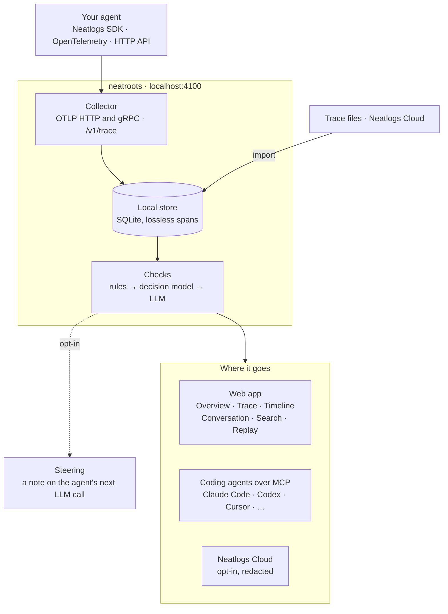

# Architecture

neatroots is one local process (`neatroots start`: port 4100, plus OTLP/gRPC on 4317) in three
layers: capture (the public SDKs, OpenTelemetry, the HTTP trace API, imports), a check orchestrator
that runs a model cascade, and the surfaces people and coding agents use.

## Code map (`packages/neatroots/src`)

| Module | Job |
| --- | --- |
| `otlp/codec.ts` | OTLP protobuf/JSON decode and lossless encode (vendored opentelemetry-proto) |
| `semantics/view.ts` | Span kind, input/output, model, tokens from public `neatlogs.*`, OpenInference and GenAI attributes |
| `store/db.ts`, `store/blobs.ts`, `store/search-ids.ts` | SQLite (WAL): sessions, runs, spans, findings, notes, plans, checks, decisions, explanations, summaries, annotations, forwards; FTS5 search (with each index row's run and span in a plain table, so lookups by run don't read the indexed text); retention |
| `server/collector.ts`, `server/readback.ts` | `/v1/traces`, `/v1/logs`, `/v1/trace`, doctor read-back |
| `ingest/` | The HTTP trace API and OTLP/gRPC (`http-trace.ts`, `grpc.ts`), span trees to OTLP (`build.ts`), and imports of trace files and Neatlogs Cloud traces (`importers/`; cloud imports run as cancellable jobs) |
| `semantics/chat-view.ts` | A run as a conversation: system, user, assistant, tool and sub-agent items |
| `replay/` | LLM-call replays through the configured LLM, and whole-agent replays through a registered command or endpoint, linked to the original run |
| `agents/chat.ts` | Claude Code and Codex chats in the app: each turn runs the agent's CLI headless with neatroots' MCP server attached; events are stored and streamed |
| `dev/mock-llm.ts` | `neatroots mock-llm`: a predictable OpenAI- and Anthropic-compatible LLM for examples and tests |
| `checks/` | YAML check schema (zod), registry, rule evaluation |
| `models/llm.ts` | The LLM: a local OpenAI-compatible server by default, or an opt-in hosted provider (Anthropic through its SDK; OpenAI-compatible APIs), with redaction, fallback to local and a priority queue (urgent notes, high decisions, low investigations) |
| `models/providers.ts` | Hosted provider presets and the strict JSON-schema rewrite hosted structured output needs |
| `models/decision.ts` | Jev typed-decision API client; router Laya → custom server → Jev cloud → LLM stand-in |
| `models/laya.ts` | Installs and supervises `laya-serve` on 127.0.0.1 with a per-install token |
| `engine/` | Orchestrator: rules, plans, questions, triage, investigations, notes, summaries, budgets |
| `steering/hub.ts` | Notes per run, atomic claim, gate wait, SSE stream |
| `mcp/` | Tool definitions (`tools.ts`, and the exploring tools in `explore-tools.ts`), streamable HTTP mount, stdio bridge |
| `relay/` | Cloud forwarding, redaction, Keychain |
| `server/api.ts`, `api-checks.ts`, `api-models.ts`, `api-explore.ts` | App and hook API (runs, views, search, imports, replays, chats), security (Host allowlist, Origin check) |
| `cli.ts`, `cli/` | The `neatroots` command; `cli/data.ts` (import, replay, rerun), `cli/connect.ts` (coding agents), `cli/service.ts` (run at login, update) |

## The cascade

| Job | Done by | When |
| --- | --- | --- |
| Decide which questions to check | local LLM (planner) | first run of a workflow; again when new tools appear |
| Rules | code | every span |
| Answer each planned question | decision model | matching spans as they arrive, and at run end |
| Label each tool result | heuristic, then decision model if ambiguous | every tool span |
| Decide whether a finding needs a closer look | decision model (score 0–4) | every finding; failed runs |
| Investigate and explain | local LLM | triage ≥ 2.5, up to 3 per run (more queue after the run) |
| Write guidance for the running agent | local LLM | when a finding is raised and steering is on |
| Check the LLM's own output | decision model | before a note is sent; on every explanation |
| Summarize a run | local LLM | run end |

"Local LLM" above means whichever LLM is configured. With a hosted provider on (`neatroots llm use`),
the same jobs go to it: the run content each prompt needs is sent with secrets removed, calls run a
few at a time instead of one, and the local LLM takes over if the provider fails. Hosted models
without token logprobs (Claude) state a confidence for each decision instead.

## Run end

A run ends when its root span arrives or the SDK's `neatlogs.trace.complete` marker does. neatroots then
runs end-only questions and any live question with unseen evidence, triages failed runs, works off
queued investigations, and writes the summary.

## Security

neatroots binds to 127.0.0.1. A Host allowlist blocks DNS rebinding; state-changing API calls from other
origins are refused; the OTLP routes allow any origin so browser SDKs can send traces. Laya runs on
127.0.0.1 behind a random token. Cloud endpoints set from the app must be `*.neatlogs.com` (or
localhost for testing). Secrets live in the macOS Keychain.

## Public inputs only

neatroots is built from public building blocks: the public Neatlogs SDKs (`neatlogs`, `neatlogs-typescript`)
and their public telemetry schema and doctor contract, OpenTelemetry, MCP, the Jev typed-decision API
as documented publicly, and openly licensed models (Laya, Apache-2.0). Checks, prompts and rules are
written for the local use case. The app UI is built from the Neatlogs design system's shared
primitives (`packages/ui/src/components/{ui,neat-ui,list-page,detail,kpi}`).

## Tests

- `packages/neatroots/test`: the server (vitest), including ingestion, Neatlogs Cloud import against a mock of its public API,
  replays through a real child process, MCP tools and the mock LLM.
- `packages/ui/e2e`: Playwright against a real server built from the repo, with an isolated home
  folder, the mock LLM and seeded runs.
- `examples/run-all.sh`: every example against a running neatroots. CI runs all three.
